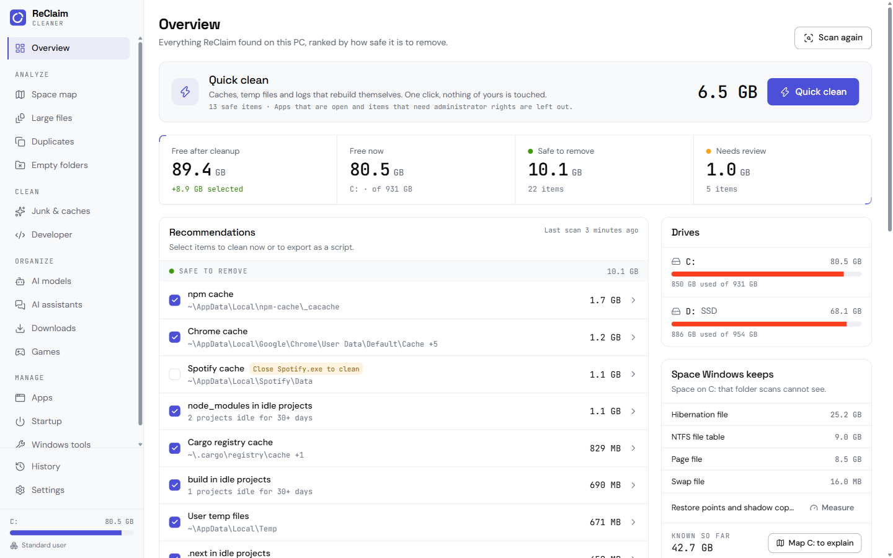
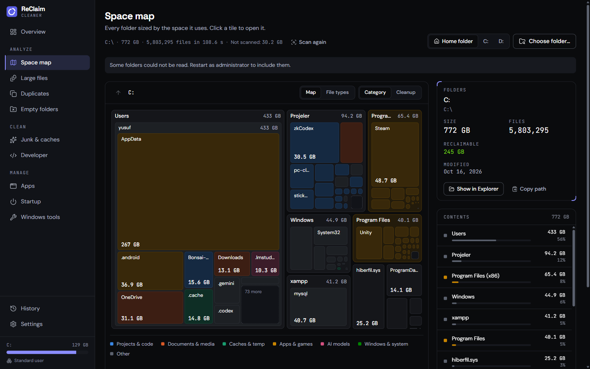
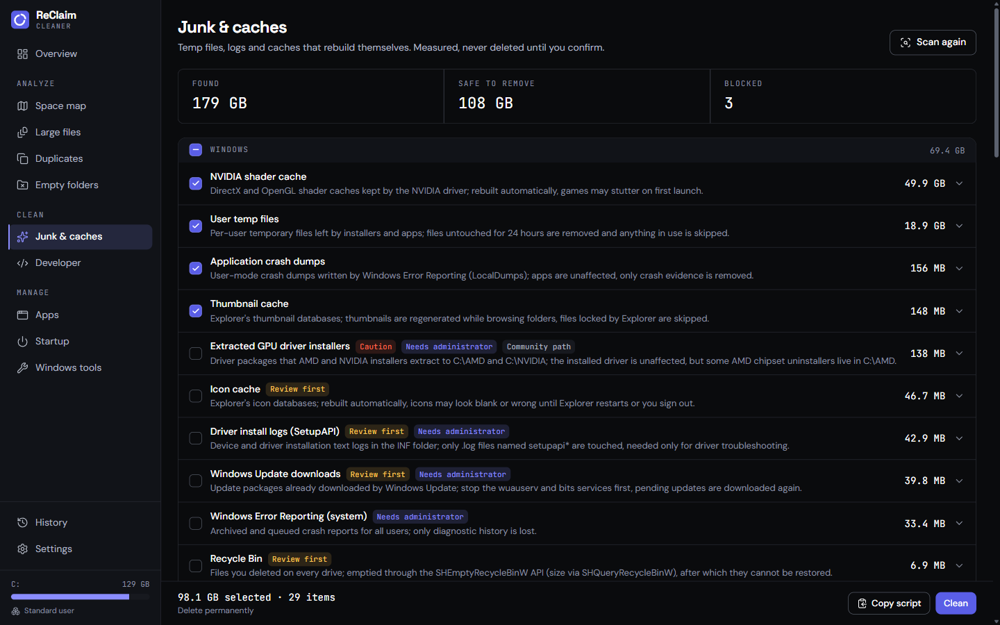

# ReClaim Cleaner

An open-source disk cleaner and space analyzer for Windows 10 and 11. It shows where your space went, ranks everything it finds by how safe it is to remove, and deletes nothing until you have reviewed it.

[Download the latest release](https://github.com/yusufky63/reclaim-cleaner/releases/latest) · [Türkçe](README.tr.md) · [How it decides what is safe](docs/architecture.md#safety-model)



## What it does

- **Overview.** Free space now and after cleanup, split into "Safe to remove" and "Needs review", with one list of recommendations you can clean or export as a PowerShell script.
- **Space map.** A treemap of any drive or folder, coloured by category (projects, media, caches, apps, AI models, Windows). The Cleanup view paints only reclaimable space.
- **Hidden space.** When a drive uses more than its folders add up to, the Space map shows where the rest is: restore points and shadow copies, reserved storage, the page and hibernation files, the NTFS file table, WSL and Docker disks, folders that could not be read. Each part links to the Windows screen that manages it.
- **Analyze from Explorer.** An optional "Analyze with ReClaim" entry on folders, folder backgrounds and drives, for the current user only. On Windows 11 it sits under "Show more options"; the new top-level menu only takes signed app packages, which ReClaim does not ship yet.
- **What is using this?** Shows which apps, services or Windows processes hold a file or folder, from Large files, the Space map and failed cleans. The only action is a graceful close, never a forced one.
- **Junk and caches.** 233 known locations: Windows temp and logs, crash dumps, browser caches (Chrome, Edge, Brave, Firefox and more), app caches (Discord, Slack, Teams, VS Code, Spotify), game launchers, and developer caches (npm, pnpm, pip, uv, Cargo, Gradle, NuGet, Go, Playwright).
- **Developer.** Finds `node_modules`, `target`, `.next`, `__pycache__`, `.venv` and 40 other build folders inside your projects, and preselects only projects you have not touched for 30 days.
- **AI models and assistants.** Every model in Hugging Face, LM Studio, Ollama and ComfyUI in one list, with copies stored by two tools flagged; and the sessions, checkpoints and logs that Claude Code, Codex and Gemini CLI keep.
- **Downloads.** Your Downloads folder by type and age, with thumbnails and browser re-downloads such as `file (1).pdf` flagged.
- **Games.** Steam libraries on every drive and the shader cache of each game, named after the game; caches of games you removed are preselected.
- **Large files, duplicates, empty folders.** Filters by type and age; duplicates are confirmed with a full BLAKE3 hash and hard links are counted once.
- **Apps and startup.** Real app icons; uninstall desktop and Store apps with their own uninstaller and check for leftovers; remove entries of apps that are already gone (with a `.reg` backup); turn startup apps off the reversible way Task Manager does.
- **Windows tools.** Recycle Bin, hibernation file, component store cleanup (DISM), Delivery Optimization and the previous Windows installation, always through Windows' own commands.
- **English and Turkish**, light and dark theme, portable mode, a local cleanup history.

| Space map | Junk and caches |
|---|---|
|  |  |

## Download

| File | For |
|---|---|
| `ReClaim-Cleaner_<version>_x64-setup.exe` | Recommended. Installs for the current user, no admin prompt, English or Turkish installer. |
| `ReClaim-Cleaner_<version>_x64_en-US.msi` / `_tr-TR.msi` | IT deployment and Group Policy. |
| `ReClaim-Cleaner_<version>_x64_portable.zip` | No installation. Settings and history stay in a `data` folder next to the exe. Needs the WebView2 runtime, which Windows 10 and 11 already include. |

Each release lists SHA-256 checksums. Builds are not code-signed yet, so Windows SmartScreen may show "Windows protected your PC". Choose **More info**, check that the publisher and file name match the release, then **Run anyway**. See [code signing](#code-signing-policy).

## Safety model

The engine enforces these rules itself, not only the UI:

1. **Preview first.** Scans never delete. Every clean runs from a list you have seen, with sizes and risk levels.
2. **Three risk levels.** Safe items (caches that rebuild themselves) are preselected. Review items are shown but not selected. Caution items stay hidden until you enable them in Settings.
3. **Protected locations.** Drive roots, Windows system folders, Program Files, your profile and library folders, OneDrive, `.git` folders and the app's own data can never be removed, by a rule or by hand. Your own exclusions apply everywhere.
4. **Links are never followed.** Junctions and symbolic links are removed as links or skipped, so a link inside a cache cannot redirect a delete. Online-only cloud files are never opened or downloaded.
5. **Running apps block their caches.** Chrome's cache is not touched while Chrome is open. Processes are never killed.
6. **Right method for the job.** Caches are deleted permanently by default because moving 10 GB of cache to the Recycle Bin frees nothing. Your own files go to the Recycle Bin by default. Both are settings, and every confirm dialog says which one applies.
7. **Least privilege.** The app runs as a normal user. Admin-only items are cleaned by the same exe started through UAC in a helper mode that receives rule ids, never paths.
8. **No registry cleaner, no tweaks, no telemetry.** The only network request is the optional update check against the GitHub API.

The full design is in [docs/architecture.md](docs/architecture.md) and the prior-art review in [docs/research.md](docs/research.md).

## Stack

- [Tauri 2](https://tauri.app) desktop shell, about 10 MB installed.
- Rust engine (`crates/core`): parallel directory walker on rayon, rule engine, cleaner, duplicate finder (xxh3 + BLAKE3), registry readers, Win32 APIs through `windows-rs`.
- React 19, TypeScript, Tailwind CSS 4, i18next, zustand.

## Build from source

Requirements: Windows 10 or 11, [Rust](https://rustup.rs) (stable, MSVC), Node.js 22 or newer, pnpm 9, and the Visual Studio C++ build tools.

```bash
pnpm install
pnpm app:dev
```

Installers end up in `target/release/bundle/` after:

```bash
pnpm app:build
```

| Script | What it does |
|---|---|
| `pnpm app:dev` | Runs the desktop app with hot reload |
| `pnpm app:build` | Builds the NSIS setup and MSI packages |
| `pnpm check` | Typecheck, lint, tests and the frontend build |
| `pnpm test` | Frontend unit tests (Vitest) |
| `cargo test --workspace` | Engine tests, including junction and protected-path cases |
| `pnpm portable` | Zips the release exe with the portable marker and writes checksums |
| `node scripts/screenshots.mjs --scan` | Captures README screenshots from the running dev app |

## Adding cleanup rules

Rules are JSON in [`rules/`](rules/). Each rule names its paths with environment variables, a mode (`contents`, `folder`, `files` or `report`), a risk level, the apps that must be closed, and a source that documents the location. CI checks every path against the same protected-path guard the cleaner uses. See [docs/rules.md](docs/rules.md); a rule request issue template is available if you would rather describe a location than write JSON.

You can also drop your own rule files into `%APPDATA%\ReClaim\rules`. User rules cannot ask for admin rights or run commands.

## Privacy

ReClaim has no accounts, analytics or crash reporting. Settings and history are plain files in `%APPDATA%\ReClaim` (or next to the exe in portable mode). The update check is off by default.

## Code signing policy

Release binaries are built by GitHub Actions from this repository. Signing through the [SignPath Foundation](https://signpath.org) program for open-source projects is planned; until then releases are unsigned and published with SHA-256 checksums.

## Contributing

Issues and pull requests are welcome. Start with [CONTRIBUTING.md](CONTRIBUTING.md); planned work is in [ROADMAP.md](ROADMAP.md). Security problems go through [SECURITY.md](SECURITY.md), not public issues.

## License

[MIT](LICENSE). Rule data and research notes were written for this project; no code or rule files were copied from GPL projects such as BleachBit.
